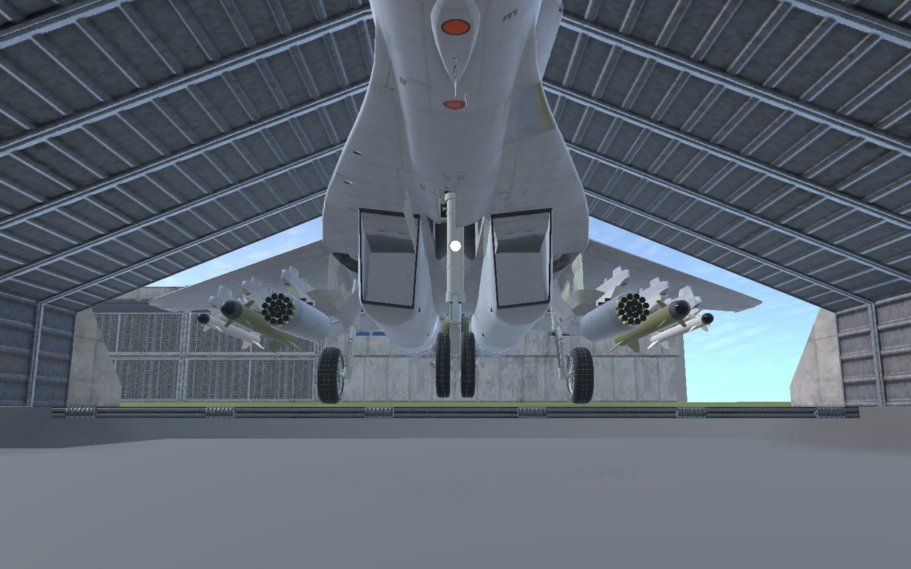
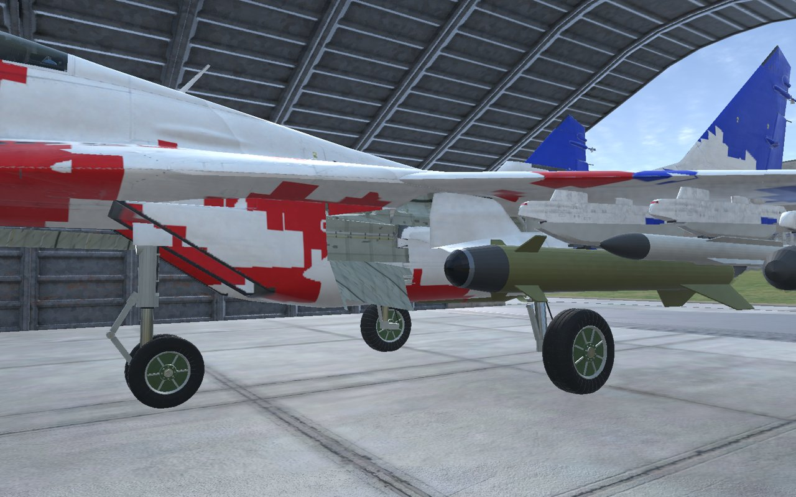
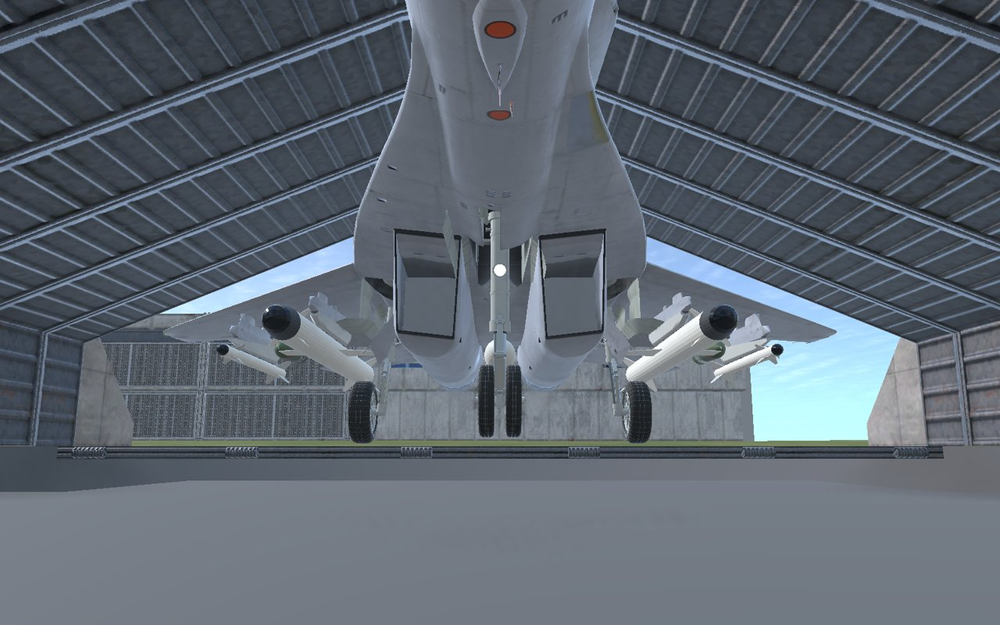
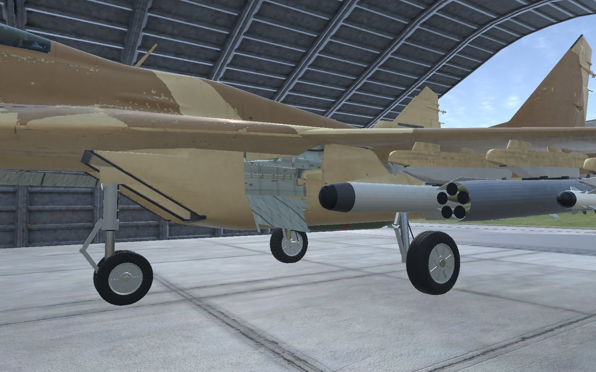
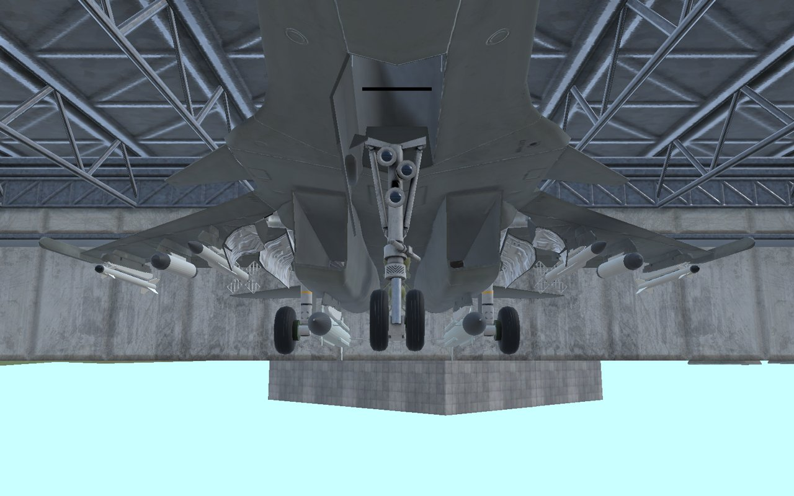

# Taiga Arsenal

> **Work in progress.** Taiga Arsenal is still being developed: stores, stations and tuning may change between versions,
> and some loadouts have rough edges (see [Known limitations](#known-limitations)). Bug reports are welcome in
> [Issues](https://github.com/IornMan1213/TaigaArsenal-NuclearOption/issues).

Soviet and Russian munitions for [Nuclear Option](https://store.steampowered.com/app/2168680/Nuclear_Option/): 50 stores
modelled at their real sizes, with the real weapons' mass, warheads, motors and seekers. Cannon rounds, air-to-air and
air-to-surface missiles, free-fall, guided and cluster bombs, rocket pods and a jamming pod.

It is an add-on for aircraft mods: it puts its weapons on the loadout menu of the supported jets below when they are installed,
without changing those mods. Remove Taiga Arsenal and the weapons are gone again.

## Supported aircraft

| Aircraft | Mod | Tested with |
|---|---|---|
| MiG-29 Fulcrum | [MiG29-NuclearOption](https://github.com/IornMan1213/MiG29-NuclearOption) | 0.9.4 |
| MiG-29SMT | [MiG29SMT-NuclearOption](https://github.com/IornMan1213/MiG29SMT-NuclearOption) | 0.2.2 |
| Su-30VXN Gandiva | [Su-30VXN-Gandiva](https://github.com/KyleisRed/Su-30VXN-Gandiva) by KyleisRed | 1.0.1 |

You need at least one of them. The weapons show only on these jets, not on the game's own aircraft. Which station takes which
store on each jet is in [docs/WEAPONS.md](docs/WEAPONS.md#stations-on-each-aircraft).

## Install

1. Install [BepInEx 5](https://github.com/BepInEx/BepInEx) into the Nuclear Option folder, and
   [Blueprinter](https://github.com/nikkorap/NOBlueprinter-Releases) 2.1.1 or newer into `BepInEx/plugins`.
2. Install one or more of the supported aircraft mods above.
3. Download `TaigaArsenal_x.y.z.zip` from the newest [release](https://github.com/IornMan1213/TaigaArsenal-NuclearOption/releases)
   and unzip it into `BepInEx/plugins/TaigaArsenal/`. Delete any older `Taiga Arsenal_*.nobp` from that folder first.
4. Start the game. In the loadout menu of a supported jet the Taiga stores are listed with the stock ones.

To uninstall, delete the `BepInEx/plugins/TaigaArsenal` folder.

**Multiplayer:** every player needs the same version of Taiga Arsenal and of the aircraft mod.

## What is in it

| Kind | Stores |
|---|---|
| GSh-30-1 cannon rounds | OFZ, OFZT, BR-T, BZT, RTP, ME, MKETF airburst, OFZT-SR |
| Air-to-air missiles | R-27ER, R-27ET, R-74M, R-77, R-24R, R-24T |
| Air-to-surface missiles | Kh-25ML, Kh-25MP, Kh-38ML, Kh-38MT, Kh-38MK, Kh-59, Kh-59M, Kh-35U, Kh-29L, Kh-29T, Kh-29TD, Kh-31A, Kh-31P |
| Bombs | KAB-500S-E, KAB-250LG-E, KAB-250S-E, KAB-500L, KAB-500Kr, FAB-100, FAB-250, FAB-500, OFAB-250-270, ODAB-500PM, BetAB-500ShP, ZAB-500, RBK-250, RBK-500, PBK-500U Drel, KMGU-2, RN-40 |
| Rockets | B-8M1 (S-8KOM), B-13L (S-13OF), UB-32 (S-5M), S-24B, S-25OF |
| Pods | MSP-418K jammer |

Every store, its guidance and its stations: [docs/WEAPONS.md](docs/WEAPONS.md).

| | |
|---|---|
|  |  |

## Known limitations

- The game has no fire damage for gun rounds and no true free-fall bombs or unguided rockets: those are close approximations
  (see [How the stores work](docs/WEAPONS.md#how-the-stores-work)).
- The game does not check whether stores on neighbouring stations overlap, so avoid pairing large stores on adjacent pylons.
- The launch rails are shaped for the MiG-29's pylons; on the other jets a store can sit a degree or two nose-up.
- Not included: the T220/E targeting pod and the internal jammers (the game has nothing to base them on).

## For aircraft modders

Want your jet supported? Open an issue with your mod's link: the pack needs your aircraft's JSON key and its hardpoint set
indices. Support is one entry in the `Jets` table in
[unity/TaigaTools/TaigaArsenal.cs](unity/TaigaTools/TaigaArsenal.cs), which maps the pack's station roles (cannon, centreline,
inner, middle, outer) to your hardpoint sets.

Building the pack from source: [docs/BUILDING.md](docs/BUILDING.md).

## Credits and license

See [CREDITS.md](CREDITS.md). Taiga Arsenal is under the [MIT License](LICENSE); the supported aircraft mods have their own
licenses. Changes in each version: [CHANGELOG.md](CHANGELOG.md).
